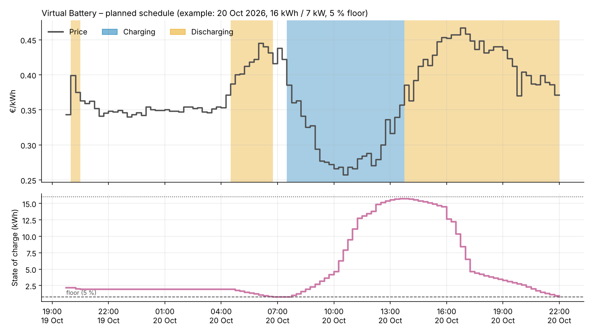
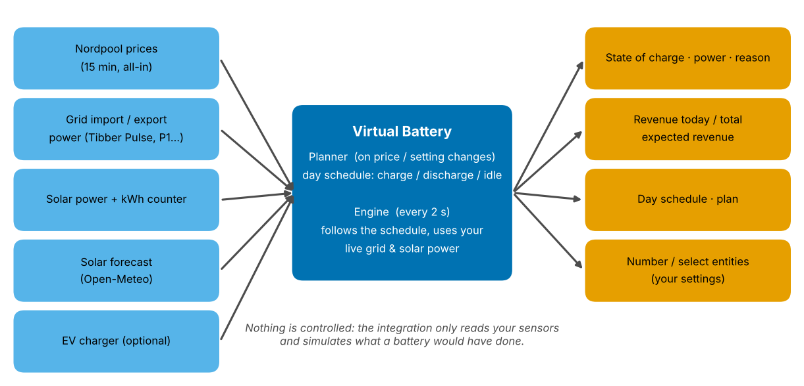
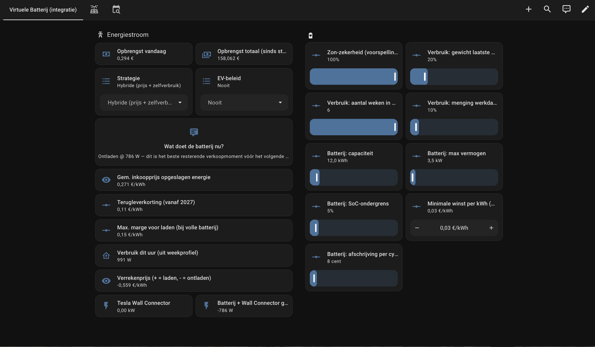
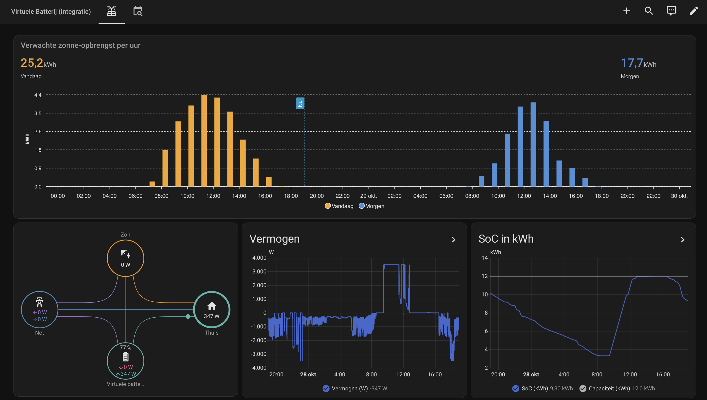
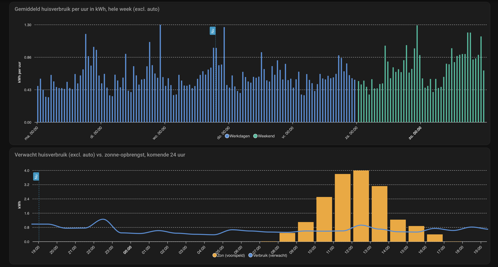
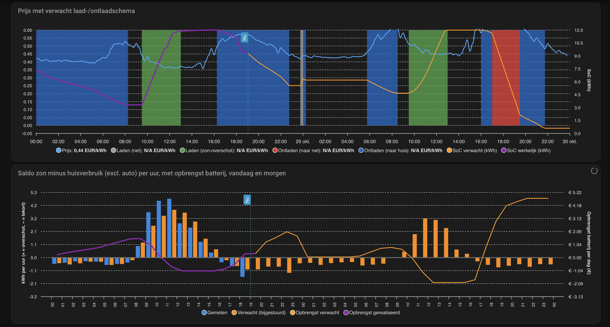
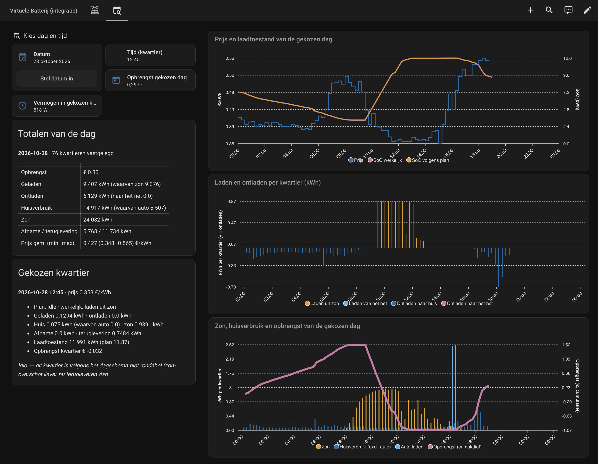
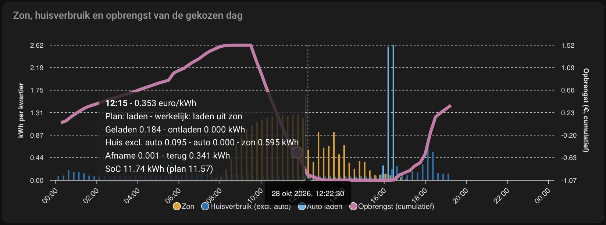

<div align="center">


# Virtual Battery

**What would a home battery earn you? Find out before you buy one.**

A Home Assistant integration that simulates a home battery on dynamic electricity prices, your own solar
panels and your own consumption, and shows the revenue it would have made. No hardware is controlled.

[](https://hacs.xyz)
[](https://github.com/onrust/virtual_battery/releases)
[](LICENSE)

[](https://ko-fi.com/onrust)

*Nederlandse versie: [README.nl.md](README.nl.md)*

</div>

---

## Contents

1. [What it does](#what-it-does)
2. [How it works](#how-it-works)
3. [Requirements](#requirements)
4. [Installation](#installation)
5. [Setup: what to fill in, and why](#setup-what-to-fill-in-and-why)
6. [Entities](#entities)
7. [Strategies](#strategies)
8. [How the planner decides](#how-the-planner-decides)
9. [Dashboard](#dashboard)
10. [Tips and troubleshooting](#tips-and-troubleshooting)
11. [Services](#services)
12. [Support the project](#support-the-project) · [Development](#development) · [Disclaimer](#disclaimer)

## What it does

* Calculates a **charge / discharge schedule** on the 15-minute prices of tomorrow and today
  (charge when cheap, discharge when expensive, taking the 15 % round-trip loss, wear and the feed-in discount into account).
* Simulates, second by second, what a battery **would have done** with your real grid and solar power, and keeps
  **revenue today / total** as if it existed.
* Six **strategies**: price optimization, hybrid (price + self-consumption), zero on the meter, charge now,
  discharge now and off.
* **Solar forecast with nowcast**: the forecast is corrected with what your panels actually delivered in the last hours.
* A self-learning **consumption profile** (per weekday and hour, excluding your EV) built from your Home Assistant statistics.
* A **minimum state of charge** (floor) that is never discharged below.
* Expected revenue for today and tomorrow, an explanation of every decision (the *reason* sensor) and a ready-made dashboard.
* English and Dutch entity names, options and reason texts (follows the Home Assistant language).

<p align="center">
  
  <br><em>Example plan for 20 October 2026 (16 kWh / 7 kW, 5 % floor): charge on cheap midday sun, discharge into the evening peak.
  Generated by the planner on real Nordpool prices. Charging is blue, discharging orange.</em>
</p>

## How it works

<p align="center">
  
</p>

The integration **only reads** your sensors. It never writes to a device, so it is completely safe to run
next to your existing setup. Two parts do the work:

1. **Planner** – recalculates the day schedule whenever new prices arrive or you change a setting. It decides *when*
   charging and discharging is worth it.
2. **Engine** – runs every 2 seconds. It follows the schedule, looks at the live power on your meter and solar inverter,
   and simulates how the battery would react: its state of charge, its power, and what that saves or earns you compared with having no battery.

## Requirements

| What | Why | Example |
|---|---|---|
| Home Assistant **2025.1** or newer with the **recorder** | statistics are used to learn your consumption and to correct the solar forecast | – |
| A **Nordpool** sensor with `raw_today` / `raw_tomorrow` (15-minute or hourly) | the prices drive the whole plan | [Nordpool integration](https://github.com/custom-components/nordpool) |
| Your **all-in price**: Nordpool configured with VAT, energy tax and your supplier's markup | revenue is computed with what you really pay and receive per kWh | Nordpool with "additional costs" template |
| **Grid power**: current import and current export, in W or kW | to know what the house draws or feeds back right now | Tibber Pulse, HomeWizard P1, DSMR |
| **Solar power** (W/kW) and a **solar energy counter** (kWh) | live production, and the actual yield for nowcast and your consumption profile | your inverter integration |
| **Grid import / export energy counters** (kWh) | to learn your consumption profile from the statistics | smart meter total counters |
| **Solar forecast** for today and tomorrow, with the attribute `wh_period_15m` | expected production for planning | [Open-Meteo Solar Forecast](https://github.com/rany2/ha-open-meteo-solar-forecast) |
| EV charger power and energy (optional) | so the car's charging does not pollute your consumption profile | Tesla Wall Connector, Easee, … |

> The (custom) icon needs Home Assistant 2026.3 or newer; older versions simply show a placeholder.

## Installation

### HACS (recommended)

1. HACS → ⋮ → **Custom repositories** → add `https://github.com/onrust/virtual_battery`, category **Integration**.
2. Search for **Virtual Battery**, click **Download** and **restart Home Assistant**.
3. **Settings → Devices & services → Add integration → Virtual Battery**.

### Manual

Copy the folder `custom_components/virtual_battery` to `<config>/custom_components/virtual_battery`,
restart Home Assistant and add the integration as above.

## Setup: what to fill in, and why

Setup has two screens. Everything on screen 1 can be changed later under **Configure** on the integration,
the numbers on screen 2 become entities you can adjust at any time.

### Screen 1 – sensors

| Field | What to choose | Why the integration needs it |
|---|---|---|
| **Name** | Default `Virtual battery`. | Determines the entity ids: `sensor.<name>_soc`, `number.<name>_capacity`, … Pick a different name (e.g. "VB test") if you want to run next to another battery simulation. |
| **Nordpool price sensor** | Your Nordpool sensor, **all-in** (incl. VAT, tax, markup). | Source of the 15-minute (or hourly) prices of today and tomorrow. The planner and the revenue calculation use these. |
| **Actual price sensor** *(optional)* | A sensor with the current all-in price per kWh. | If you leave this empty the current Nordpool state is used. Fill it in only if you have a separate price sensor that is more exact. |
| **Grid import power** | The sensor with the power you **draw** from the grid right now, in **W or kW**. Example (Tibber Pulse): `sensor.<home>_power`. | Tells the engine how much the house needs from the grid. The battery would discharge to cover this. |
| **Grid export power** | The sensor with the power you **feed back** right now, in **W or kW**. Example (Tibber Pulse): `sensor.<home>_stroomproductie`. | Tells the engine how much solar surplus is available to charge from, or how much a discharge would add to your export. |
| **Solar power** | Current power of your solar installation (W/kW). | Used to calculate the real house consumption (grid + solar) and to charge from surplus. |
| **Solar energy (kWh counter)** | The total (increasing) kWh counter of your solar yield. | Used by the **nowcast** (comparing forecast and reality) and for the consumption profile. Needs long-term statistics (`state_class: total_increasing`). |
| **Grid import energy (kWh counter)** | Total kWh drawn from the grid. | Consumption profile (house consumption = import + solar − export − EV). |
| **Grid export energy (kWh counter)** | Total kWh fed back. | Idem. |
| **EV charger power** *(optional)* | Power of your wall charger. | Lets the engine and the profile treat the car separately (see *EV policy*). |
| **EV charger energy** *(optional)* | Total kWh of the charger. | Removes the car from the consumption profile, so it learns your *house*, not your car. |
| **Solar forecast today / tomorrow** | The Open-Meteo Solar Forecast "energy production today / tomorrow" sensors (attribute `wh_period_15m`). | Expected production per 15 minutes. Scaled by the **solar certainty** and corrected by the nowcast. |
| **Solar forecast remaining today** *(optional)* | "Energy production remaining today". | Used by the *Zero on the meter* strategy to judge how much sun is still to come. |

> **Watch out:** the grid sensors must be **power** (W/kW), not cost or energy sensors. A sensor with unit `EUR` or `kWh`
> there will give a meaningless simulation.

### Screen 2 – battery

| Field | Default | What it means |
|---|---|---|
| **Capacity** | 8 kWh | Usable capacity of the battery you want to simulate. |
| **Maximum charge/discharge power** | 2.5 kW | The most the battery can charge or discharge at once. |
| **Depreciation per full cycle** | 8 cent | What a full cycle costs you in wear. Charging one kWh costs `depreciation / capacity`; the planner only plans a cycle if it earns more than this. |
| **Feed-in discount** | € 0.11 / kWh | What you lose per kWh you feed back: the difference between what you pay for a kWh and what you are paid for a kWh you export (feed-in costs, end of net metering). Making this realistic is the single most important setting: it decides whether storing solar surplus beats exporting it. |

All four become number entities, so you can try other values on the fly. The round-trip efficiency is fixed at 85 %.

## Entities

Entity ids follow `<domain>.<name>_<key>`, e.g. for the default name `sensor.virtual_battery_soc`.

### Sensors

| Entity (key) | Unit | What it tells you |
|---|---|---|
| `soc` | kWh | Energy currently stored. |
| `soc_percent` | % | State of charge relative to the capacity. |
| `power` | W | Battery power right now: **+ charging, − discharging**. |
| `charge_power` / `discharge_power` | W | The same, split into two positive numbers (handy for the power-flow card). |
| `combined_power` | W | Battery power plus the EV charger. |
| `house_consumption` | W | Real consumption of the house: grid + solar. |
| `effective_import` / `effective_export` | W | What your meter would show **with** the battery. Compare with the real meter to see the effect. |
| `revenue_today` | € | What the battery has earned today: your electricity bill *without* it minus *with* it. Resets at midnight. |
| `revenue_total` | € | Running total since start. |
| `expected_revenue` | € | Forecast of today's final revenue. The attributes (`reeks`, `soc_reeks`, `laad_split`, `ontlaad_split`) feed the dashboard charts, and `verwacht_morgen` holds tomorrow's expectation. |
| `average_cost` | €/kWh | Weighted average purchase price of the energy in the battery (energy below the floor is ignored). The engine will only discharge for self-consumption if this beats the alternative. |
| `settlement_price` | €/kWh | What the energy moved in the current moment was "worth": positive when charging (cost), negative when discharging (saving). |
| `reason` | text | Plain-language explanation of what the battery does now and why ("Discharging @ 880 W — self-consumption now (€0.391) beats selling later (net €0.348)"). |
| `plan` | text | Which plan the planner chose, *A* or *B* (see below), and its advantage in €. |
| `schedule_code` | text | The day schedule as a compact string: start time, then one letter per 15 minutes: **I**dle, **L** charge, **O** discharge. Used by the dashboard. |
| `solar_forecast` | kWh | Solar forecast after the nowcast correction (attributes: per-period values). |
| `expected_consumption` | W | Expected consumption in this hour from the learned profile; attributes hold the whole week and the coming hours. |

### Numbers (your settings)

| Entity | Range | Meaning |
|---|---|---|
| `capacity` | 1–100 kWh | Battery capacity. |
| `max_power` | 0.5–50 kW | Maximum charge/discharge power. |
| `min_soc` | 0–50 % | **Floor**: the battery never discharges below this level. The planner only uses the band above it and the average purchase price ignores the energy below it. 0 = off. |
| `depreciation` | 0–100 cent | Wear cost per full cycle. |
| `feed_in_discount` | 0–1 €/kWh | Loss per kWh exported. |
| `min_margin` | 0–0.30 €/kWh | **Minimum profit per kWh** (default 3 ct). The planner only schedules a charge/discharge pair if it earns more than this per kWh charged, after round-trip loss and wear. Filters out tiny cycles that cost more in standby and inverter losses than they earn. 0 = off. |
| `max_margin` | 0–1 €/kWh | *Zero on the meter* only: how much cheaper a later sale must be before the battery is *not* charged from surplus now. Scales with the state of charge, so a nearly full battery is more reluctant. |
| `solar_certainty` | 0–100 % | How much you trust the forecast. 100 % uses it as is, 60 % assumes you get 60 %. A lower value plans more cautiously. |
| `profile_weeks` | 2–6 | Number of weeks the consumption profile averages. |
| `profile_weight_last` | 0–100 % | Extra weight of the most recent week (recent habits count more). |
| `profile_mix` | 0–100 % | How much weekdays and weekend days are blended (0 = fully separate profiles). |

### Selects

| Entity | Options |
|---|---|
| `strategy` | Price optimization · Hybrid (price + self-consumption) · Zero on the meter · Charge now · Discharge now · Off |
| `ev_policy` | **Never** (the battery may not power the car) · **Evenings/nights only** · **Always allowed (if profitable)**. Only matters while your car charges. |

### History (day archive)

Every quarter hour the integration stores one record (price, charged/discharged kWh, house, solar, import/export, revenue, state of charge, planned action and the reason) in `.storage`, one file per month, kept for **2 years**. On first start the last ~10 days are filled in from the recorder (without the planned action).

| Entity | Purpose |
|---|---|
| `date.<name>_view_date` | Pick a day. Choosing today follows today again. |
| `time.<name>_view_time` | Pick a time of day (the matching quarter is shown). |
| `sensor.<name>_day_view` | State = revenue of that day (€). Attributes: totals and per-quarter series for charts. Updates after every finished quarter. |
| `sensor.<name>_moment_view` | State = average battery power in the picked quarter (W, - = discharging). Attributes: price, state of charge, planned action, reason, etc. |

## Strategies

| Strategy | What the simulated battery does |
|---|---|
| **Price optimization** | Follows the day schedule: charges in cheap quarters, discharges in the best expensive ones. When a better moment is still ahead before the next charge, it waits. |
| **Hybrid (price + self-consumption)** *(default)* | Like price optimization, but also covers your own consumption from the battery whenever your import price is higher than what the stored energy would earn later. It also stores solar surplus when that beats exporting it. |
| **Zero on the meter** | Classic home-battery behaviour: charges from solar surplus (unless a later sale is clearly better, see `max_margin`) and discharges to bring the meter to zero. Includes an emergency valve in the afternoon for a low battery. |
| **Charge now** / **Discharge now** | Full power until full or down to the floor. For testing. |
| **Off** | The battery does nothing. |

## How the planner decides

* It looks at **all known 15-minute prices** (today, plus tomorrow once published) and pairs cheap *charge* quarters with later expensive *discharge* quarters.
* A pair is only worth it if `sale price × 0.85 − purchase price − wear > minimum profit` (`min_margin`). Round-trip loss, wear and the **feed-in discount** are all in the maths.
* The same test applies to "power the house from the battery now, recharge cheaply later" (discharge before charge), e.g. an evening peak followed by a night trough.
* Energy that your **house consumes itself** is worth the full price; only what you export is worth *price − feed-in discount*. The expected consumption comes from your own learned profile.
* **Solar surplus** (forecast × certainty − expected consumption) is cheap to store because it would otherwise be exported with a discount.
* Existing stored energy is spread over the best discharge quarters first.
* Two plans are calculated when sun is expected: **A** (considers paid alternatives for every discharge) and **B** (simply sells the stock at the highest net prices). A is chosen only if it beats B by more than €0.10.
* A running charge or discharge series is not interrupted halfway.
* With a **floor** set, the planner plans on the band above it.

## Dashboard

The integration builds a ready-made dashboard **with your own entities** (three views: settings, forecast and history). The card titles are in Dutch.

<p align="center">
  <br><em>Settings: revenue, strategy, what the battery is doing now, and all settings</em>
</p>

<p align="center">
  <br><em>Forecast: expected solar yield, power flow, battery power and state of charge</em>
</p>

<p align="center">
  <br><em>Forecast: average house consumption per hour and the expected consumption versus solar for the next 24 hours</em>
</p>

<p align="center">
  <br><em>Forecast: price with the expected charge/discharge schedule, and the daily balance with revenue</em>
</p>

<p align="center">
  <br><em>History: pick a day and time, with totals, the chosen quarter and charts of that day</em>
</p>

<p align="center">
  <br><em>History: hover over a bar for all details of that quarter; click to select it</em>
</p>

**Needs (via HACS, Frontend):** [apexcharts-card](https://github.com/RomRider/apexcharts-card) and [power-flow-card-plus](https://github.com/flixlix/power-flow-card-plus).

1. Go to **Developer tools → Actions**, pick **Virtual Battery: Generate dashboard** and press **Perform action**. The response shows the finished dashboard; it is also saved as `/config/virtual_battery/dashboard.yaml`.
2. Create a new dashboard: **Settings → Dashboards → Add dashboard → New dashboard from scratch**, then open it.
3. Press the pencil (edit) → the three dots → **Raw configuration editor**, remove what is there, paste the dashboard (copy the whole response of the action, or the file `dashboard.yaml`) and save.

Prefer a dashboard that updates itself with the integration? Add this to `configuration.yaml` and restart (the dashboard is then read-only in the UI):

```yaml
lovelace:
  dashboards:
    virtual-battery:
      mode: yaml
      title: Virtual battery
      icon: mdi:battery-heart-variant
      show_in_sidebar: true
      filename: virtual_battery/dashboard.yaml
```

Run the action again after an update of the integration to refresh the file.

## Tips and troubleshooting

* **Revenue looks strange / negative:** check that the Nordpool sensor is really all-in, and that **grid import / export** are power sensors (not cost sensors).
* **Units:** both W and kW are accepted for the power sensors, the integration converts.
* **Run it next to an existing implementation:** the integration writes nothing back, so just give it a different name.
* **The plan changes every few minutes:** the planner recalculates when prices, settings or the profile change; the current block's action is protected, so a running series is not cut short.
* **No consumption profile yet:** the first days the fallback (400 W) is used until enough statistics are available (a few weeks give the best results).
* **Entity ids:** they are based on the name you entered, not on the language, so dashboards keep working when you switch language.
* **Single instance:** only one Virtual Battery can be configured per Home Assistant.

## Services

`virtual_battery.set_state` – set the starting state (state of charge in kWh, average cost, total and daily revenue),
for example to copy the state of an existing battery or a simulation you ran elsewhere.

`virtual_battery.import_history` – fill the day archive from the recorder history (`days`, default 10). Existing quarters are kept.

## Support the project

Virtual Battery is free and open source. If it saves you money or time, you can buy me a coffee:

[](https://ko-fi.com/onrust)

Ideas, bug reports and pull requests are very welcome in the [issue tracker](https://github.com/onrust/virtual_battery/issues).

## Development

```
python -m venv .venv && .venv/bin/pip install pytest-homeassistant-custom-component
.venv/bin/python -m pytest
```

The calculation modules are independent of Home Assistant and live in `custom_components/virtual_battery/logic/`.

## Disclaimer

This is a **simulation** for insight, not financial advice. Results depend on the quality of your prices, forecast and settings,
and real batteries have additional losses and limits (standby consumption, temperature, inverter efficiency, warranty rules).
